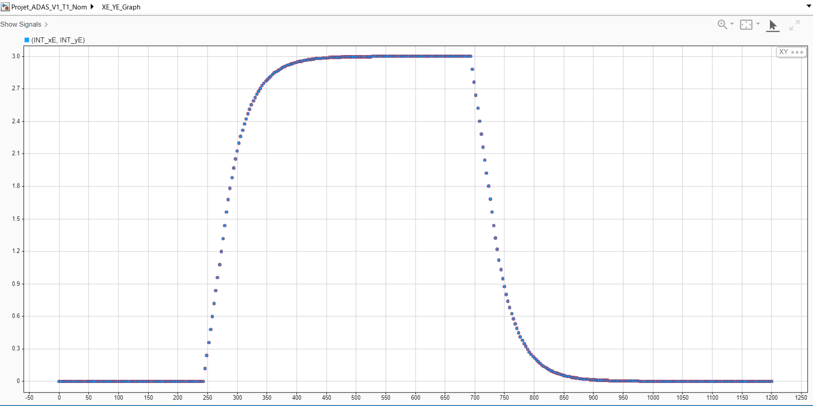

# ADAS Overtaking Simulation

A MATLAB/Simulink model of a simplified overtaking maneuver on a straight racing track. The ego vehicle follows a slower car, checks whether an overtake is possible, moves sideways to pass, and returns to the racing line.

The model combines relative-distance estimation, short-horizon prediction, a discrete maneuver decision, a fixed lateral path reference, and proportional control.



## Model

The simulation is organized into five MATLAB Function blocks embedded in the Simulink models:

- **Perception:** relative distance, closing speed, and time to collision (TTC).
- **Prediction:** target and ego longitudinal positions after a 2-second constant-speed horizon.
- **Decision:** four modes: follow (0), overtake (1), return (2), and finished (3).
- **Planning:** a fixed lateral reference of +3 m or -3 m, depending on which side is available.
- **Control:** saturated proportional control of longitudinal acceleration and lateral speed.

The ego vehicle uses a simple kinematic representation with longitudinal position, longitudinal speed, and lateral position. This is a maneuver-logic simulation rather than a full vehicle-dynamics model.

## Test cases

| Case | Conditions | Expected behavior |
| --- | --- | --- |
| T1 — Nominal | Left side free; track half-width 5 m | Overtake and return to the racing line |
| T2 — Blocked sides | Both sides unavailable; track half-width 5 m | Reject the overtake and continue following |
| T3 — Narrow track | Left side free; track half-width 3.5 m | Reject the overtake because of limited space |

The `results/` directory contains captured Simulink scopes and trajectory plots for these three scenarios. Only T1–T3 are included; other configurations have not been documented here.

## Run the simulation

1. Open MATLAB with Simulink installed. The models were saved using **MATLAB R2024b**.
2. Open one of the `.slx` files in `models/`.
3. Click **Run**. The model is configured for a **40-second** simulation with a **0.1-second** fixed step.
4. Open the Scope blocks to inspect the maneuver mode, longitudinal gap, position, and lateral reference.

Start with `models/ADAS_Overtaking_T1_Nominal.slx` for the complete maneuver. The base model is also provided, along with separate models for T2 and T3. The MATLAB Function code is embedded in each `.slx` file; no external script is required to run these models.

## Repository structure

```text
models/
  ADAS_Overtaking_Base.slx
  ADAS_Overtaking_T1_Nominal.slx
  ADAS_Overtaking_T2_BlockedSides.slx
  ADAS_Overtaking_T3_NarrowTrack.slx
results/
  T1_nominal/
  T2_blocked_sides/
  T3_narrow_track/
README.md
```

## Limitations

This is a simulation prototype using idealized vehicle state inputs and a straight-track scenario. It does not model steering dynamics, sensing errors, changing traffic conditions during a maneuver, or emergency handling. The planning step selects a fixed offset rather than solving a trajectory-optimization problem; the controller is proportional, **not MPC**. The screenshots are from the supplied simulation runs; the models were not re-executed during repository cleanup.
